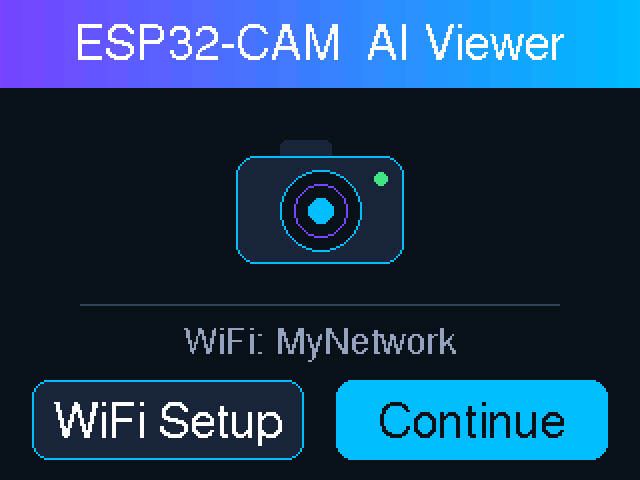
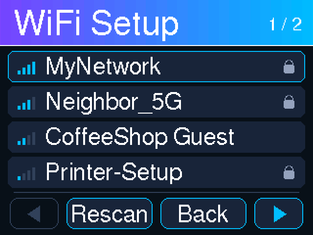
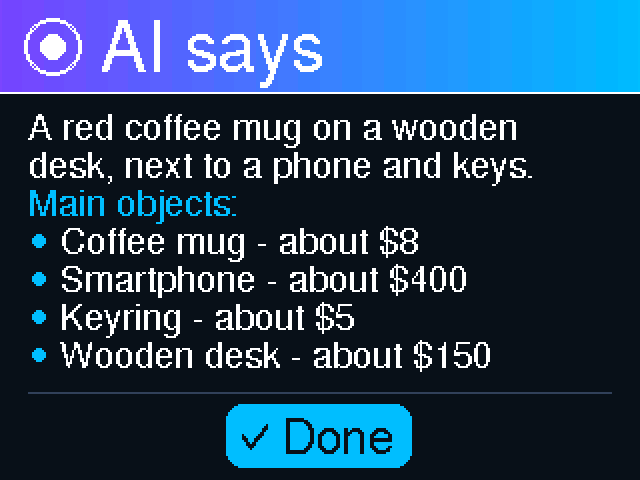
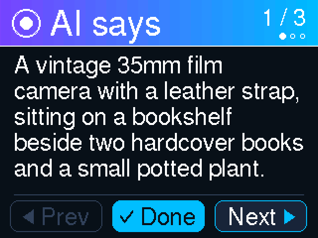
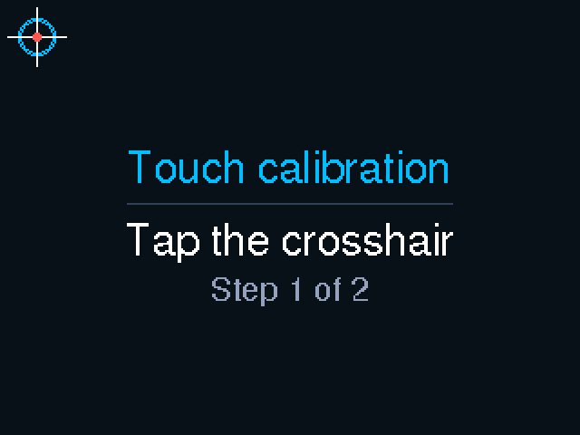
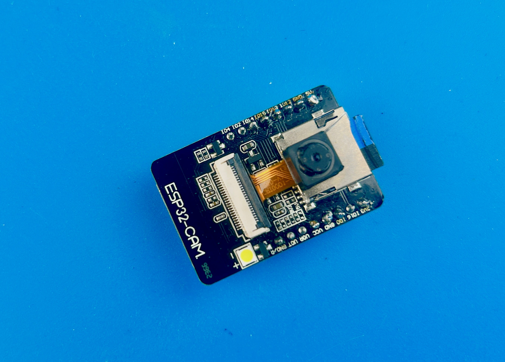
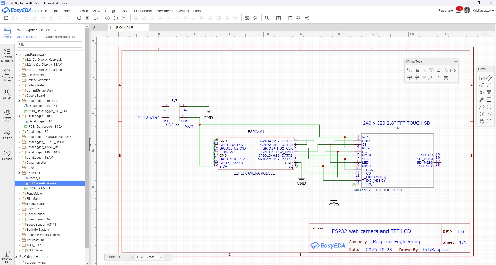

# ESP32-CAM AI Viewer

Point a $10 camera at something, tap the screen, and an AI tells you what it sees (and roughly what it's worth).

An AI-Thinker ESP32-CAM shows live video on a 2.8" touch display. Tap the screen and it takes a photo, sends it to Google's Gemini AI (free tier), and shows the answer on screen. Every photo and answer is saved to the onboard microSD card. A fun weekend project for about **$50** in parts.

> 🎬 **A YouTube video walking through the build is coming soon!** I'll add the link here once it's up.

## Screens

| Start-up | WiFi Setup |
|:---:|:---:|
|  |  |
| **AI result** | **Long answers get pages** |
|  |  |
| **Touch calibration** | **The ESP32-CAM** |
|  |  |
 

*Screens rendered pixel-for-pixel from the sketch's drawing code and fonts. The AI answers are examples.*

## Features

- Live camera video on a 320x240 touch display
- Tap anywhere to take a photo and ask Gemini what's in it; the answer is word-wrapped, with **Prev / Next** pages for long answers
- Automatic **LED flash** when the scene is dark
- Photos and answers saved to microSD as `IMG_0001.jpg` + `IMG_0001.txt`, never overwriting existing files
- On-screen **WiFi Setup**: scan, pick a network, type the password; saved in flash
- On-screen **touch calibration**, saved in flash
- Retries automatically when Gemini is busy (HTTP 503)
- The original ESP32 camera web page still works at `http://<camera IP>`

## Hardware

| Part | Notes |
|---|---|
| AI-Thinker ESP32-CAM with OV2640 camera | must have PSRAM (the AI-Thinker board does) |
| ESP32-CAM-MB USB programmer board | for uploading and the Serial Monitor |
| 2.8" ILI9341 SPI TFT with XPT2046 touch (320x240) | the common red "SPI TFT touch" module |
| microSD card | FAT32, 32 GB or smaller recommended |
| 5V USB power supply, hookup wire | |

## Wiring

| Display / touch pin | ESP32-CAM |
|---|---|
| VCC | 5V |
| GND | GND |
| CS | GPIO 15 |
| RESET | 3.3V (the sketch uses a software reset) |
| DC | GPIO 2 |
| SDI (MOSI) | GPIO 13 |
| SCK | GPIO 14 |
| LED (backlight) | 3.3V |
| SDO (MISO) | not connected |
| T_CLK | GPIO 14 (shared with SCK) |
| T_DIN | GPIO 13 (shared with SDI) |
| T_DO | GPIO 4 (also the flash LED) |
| T_CS | GPIO 12 |
| T_IRQ | not connected |

**Pins to watch out for**

- **GPIO 0, 1, 3, 16** are used by the camera clock, the serial port, and PSRAM. Don't use them.
- **GPIO 12** must be low at power-up or the ESP32 won't boot. If yours won't boot with T_CS connected, burn the flash-voltage fuse once: `espefuse.py set_flash_voltage 3.3V` (permanent).
- **GPIO 2, 14, 15** are shared by the display and the microSD slot. The sketch makes them take turns (the card is only mounted while a file is written), so the screen blinks briefly on each save.
- **GPIO 4** drives the flash LED and is the touch panel's T_DO line. The sketch only uses the flash while taking a photo.

## Software

1. Install the **ESP32 board package** (tested with 3.3.x): https://github.com/espressif/arduino-esp32
2. Install these libraries (Arduino IDE: *Tools > Manage Libraries*):

   | Library | Link |
   |---|---|
   | Adafruit GFX Library (and Adafruit BusIO) | https://github.com/adafruit/Adafruit-GFX-Library |
   | Adafruit ILI9341 | https://github.com/adafruit/Adafruit_ILI9341 |
   | TJpg_Decoder (Bodmer) | https://github.com/Bodmer/TJpg_Decoder |
   | XPT2046_Touchscreen (Paul Stoffregen) | https://github.com/PaulStoffregen/XPT2046_Touchscreen |
   | Adafruit_ILI9341_Keypad | https://github.com/KrisKasprzak/Adafruit_ILI9341_Keypad |

   Use Adafruit_ILI9341_Keypad **version 6.2 or later**. Older versions limit the on-screen keyboard to 11 characters, which is too short for most WiFi passwords.

3. Board settings: **AI Thinker ESP32-CAM**, partition scheme **Huge APP (3MB No OTA/1MB SPIFFS)**.

## Setup

1. Get a free Gemini API key at https://aistudio.google.com/apikey
2. Open `ESP32_VideoCamera.ino` and paste it into `GEMINI_API_KEY` in the **User settings** section.
   *Don't commit your real key to a public repo.*
3. Upload to the board.
4. First boot:
   - **Touch calibration** runs automatically: tap the two crosshairs, then draw to test.
   - **WiFi Setup** opens: pick your network and type the password.

   Both are saved in flash. To recalibrate later, tap the splash screen during the 3-second countdown at boot.

## Using it

| Action | Touch | Serial Monitor |
|---|---|---|
| Take a photo and ask the AI | tap anywhere on the live video | `t` |
| Back to live video | **Done** | `n` |
| Page through a long answer | **Prev / Next** | `<` / `>` |

Files on the SD card are saved in `/AI_Photos`. Each text file has the photo name, model, prompt, and Gemini's full answer.

## Settings

Everything you might want to change is in the **User settings** section near the top of the sketch:

| Setting | What it does |
|---|---|
| `GEMINI_API_KEY` | your Gemini API key |
| `GEMINI_MODEL` | which Gemini model to use (the comment lists other free models to try if you get frequent "busy" errors) |
| `AI_PROMPT` | the question sent with each photo |
| `CAMERA_BRIGHTNESS`, `CAMERA_AE_LEVEL`, `CAMERA_GAIN_CEILING`, ... | camera picture settings |
| `FLASH_MODE`, `FLASH_DARK_LEVEL`, `FLASH_BRIGHTNESS` | LED flash: off / auto / on, when auto fires, and how bright |
| `DEFAULT_SSID`, `DEFAULT_PASSWORD` | optional WiFi default used until one is saved on screen |

## Troubleshooting

| Problem | Try |
|---|---|
| "Gemini busy" / HTTP 503 errors | wait a minute, or switch `GEMINI_MODEL` to another free model |
| Garbled picture on the display | lower the SPI speed in `setupDisplay()`: `tft.begin(20000000)` |
| Taps land in the wrong place | recalibrate: tap the splash screen during the countdown at boot |
| Won't boot after wiring the touch panel | see the GPIO 12 note above |
| "No SD card" | use a FAT32 card, 32 GB or smaller |

## Credits

- Camera driver and web server: Espressif's **CameraWebServer** example (`app_httpd.cpp`, `camera_index.h`, `camera_pins.h`, Apache License 2.0)
- Display, touch, and JPEG libraries by Adafruit, Paul Stoffregen, and Bodmer (links above)
- AI image recognition: Google Gemini API
- Built with help from AI (Claude by Anthropic) to tie all the pieces together

## License

MIT. See [LICENSE](LICENSE). The Espressif example files keep their Apache 2.0 license.
